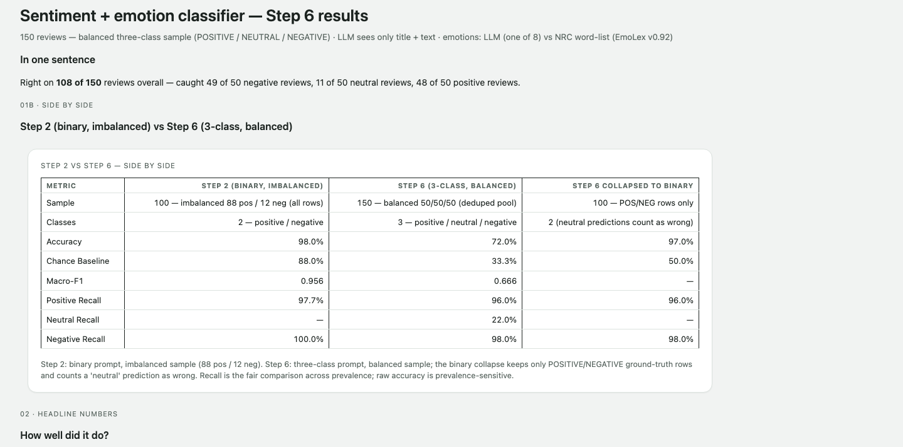
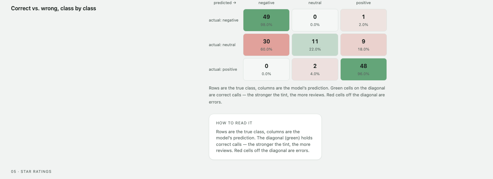
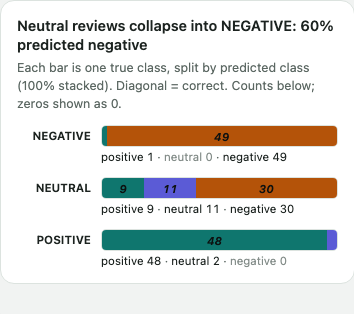
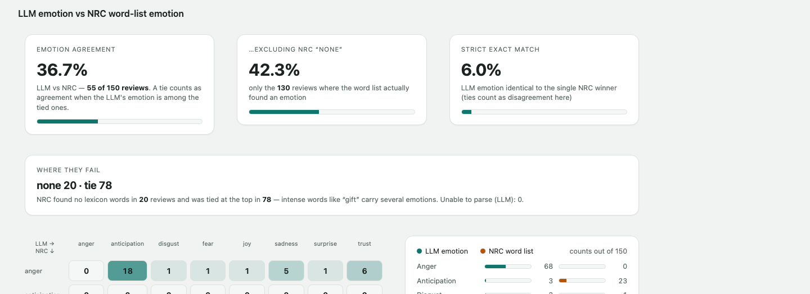
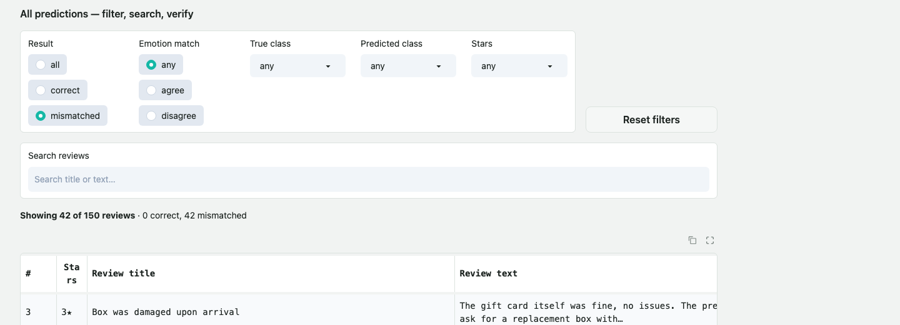
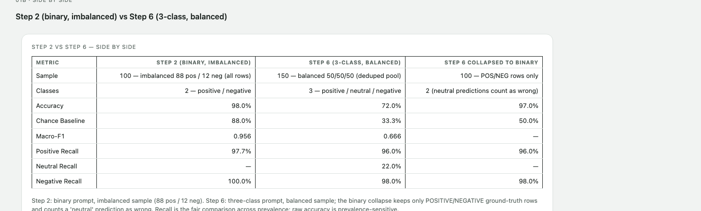

# LLM Sentiment & Emotion Classification of Amazon Gift Card Reviews

LLM-based sentiment and emotion classification of the Amazon Reviews '23 **Gift Cards** category. A
binary (positive/negative) run on an imbalanced seed-42 sample achieves **98.0% accuracy** but is
deceptively easy: 88% of the sample is positive and the always-positive baseline is 88.0%. A
**three-class balanced run** (50 reviews per ground-truth class, seed 42) drops accuracy to **72.0%
vs a 33.3% chance baseline** and exposes the real weakness: **NEUTRAL reviews are caught only 22%
of the time** — 60% of 3-star reviews are pulled into NEGATIVE by complaint-heavy text. A second,
independent emotion signal (the NRC word-list lexicons) agrees with the LLM's primary emotion on
**36.7%** of reviews; the two methods disagree mostly where the lexicon is blind to context or
negation. This repository contains the pipelines, the full outputs (`outputs/`), the Gradio
dashboard that visualizes everything, and a Playwright verification suite that proves every number
on the dashboard matches the metrics files.

## Data source

- **Amazon Reviews '23** – McAuley Lab, UCSD. Dataset page:
  <https://amazon-reviews-2023.github.io/> · Paper: Yupeng Hou, Jiacheng Li, Zhankui He, An Yan,
  Xiusi Chen, Julian McAuley, *Bridging Language and Items for Retrieval and Recommendation*,
  2024, arXiv:2403.03952.
- Category file (Gift Cards):
  <https://mcauleylab.ucsd.edu/public_datasets/data/amazon_2023/raw/review_categories/Gift_Cards.jsonl.gz>
- **152,410** raw reviews; **133,009** after deduplication (identical title+text collapsed, first
  occurrence kept — see `src/step6_pipeline.py`). Research/non-commercial license, per the
  dataset page; the data file is not committed (download with `./setup.sh`).

### NRC Emotion Lexicon (EmoLex)

Word-level lexicon used for the model-free emotion baseline:
- Saif M. Mohammad and Peter D. Turney, *Crowdsourcing a Word-Emotion Association Lexicon*,
  Computational Intelligence 29(3), 436–465, 2013.
- Official site: <http://saifmohammad.com/WebPages/NRC-Emotion-Lexicon.htm> · file:
  `NRC-Emotion-Lexicon-Wordlevel-v0.92.txt` (download via `./setup.sh`; not committed).
- License: non-commercial research use (see the NRC lexicon page). Only the 8 emotion columns are
  used (anger, anticipation, disgust, fear, joy, sadness, surprise, trust); the positive/negative
  tags are ignored.

## Method

- **Model & endpoint:** an OpenAI-compatible course endpoint (default
  `http://dobolyi.com:9000/v1`), model `DeepSeek-V4-Flash-0731`, `temperature=0`,
  `max_tokens=1024`. The API key is read **only** from the `LLM_API_KEY` environment variable
  (see `.env.example`) — no key appears anywhere in this repository.
- **The model sees only title + text.** The rating is never interpolated into the prompt
  (verified in `src/sentiment_classifier.py`).
- **Ground truth, binary (Step 2):** rating ≥ 4 → positive, else negative.
- **Ground truth, three-class (Step 6):** rating 4–5 → positive, 3 → neutral, 1–2 → negative.
- **Sampling:** Step 2 — one fixed seed-42 sample of 100 reviews from the full file. Step 6 — a
  balanced draw of 50 per class (150 total) from the deduped pool, `random.Random(42)`; the exact
  sampled review IDs are in `outputs/step6_sample.csv`.
- **Final prompt** (also in `prompt/final_prompt.txt`), with prompt-versioned cache keys so older
  answers are never reused:

```
Classify the sentiment of this Amazon product review as "positive", "neutral" or "negative", and its primary emotion. The emotion MUST be exactly one of: anger, anticipation, disgust, fear, joy, sadness, surprise, trust.

How to decide:
- "positive": clearly favorable, enthusiastic, or satisfied. Mostly praise with a minor gripe is still positive.
- "negative": clearly unfavorable, disappointed, or angry. Mostly complaint with a small positive is still negative.
- "neutral": genuinely mixed (real pros and cons with neither dominating), lukewarm or indifferent ("it's okay", "does the job"), or purely factual with no opinion.

Title: {title}
Text: {text}

Return ONLY a JSON object like {"sentiment": "positive", "emotion": "joy"} (or "neutral", or "negative", each with one of the 8 emotions listed above).
```

## Results

### Q1 – Why did the lopsided run look so accurate, and what did balanced sampling change?

The binary run scored **98.0% accuracy (98/100)** — but the sample was 88% positive, so always
predicting "positive" already yields 88.0%. With balanced sampling (50/50/50) accuracy falls to
**72.0% vs the 33.3% chance baseline** (macro-F1 0.666, balanced accuracy 72.0%). Per-class recall,
before (binary, imbalanced) vs after (three-class, balanced):

| class | Step 2 recall | Step 6 recall |
|---|---|---|
| positive | 97.7% (86/88) | 96.0% (48/50) |
| negative | 100.0% (12/12) | 98.0% (49/50) |
| neutral | — | **22.0% (11/50)** |

Collapsing the balanced run back to binary (POS/NEG rows only, neutral predictions counted as
wrong) gives 97.0% − so the binary-class performance is largely unchanged; the entire observed
accuracy drop is the NEUTRAL class.

### Q2 – Where do the mistakes go? (3×3 confusion, `outputs/step6_metrics.json`)

| truth \ predicted | negative | neutral | positive | recall |
|---|---|---|---|---|
| **negative** | 49 | 0 | 1 | 98.0% |
| **neutral** | 30 | 11 | 9 | 22.0% |
| **positive** | 0 | 2 | 48 | 96.0% |
| precision | 62.0% | 84.6% | 82.8% | |

- **3-star NEUTRAL destination: 30 → negative, 11 → neutral, 9 → positive.** 3-star texts in this
  category are predominantly complaint-with-caveat, so the rating says "neutral" but the words read
  negative.
- 1 of 50 negatives was called positive ("Nothing" — text literally says "Loved it"); 2 of 50
  positives were called neutral ("Son in law gift", "Everything ok" — factual/lukewarm text).
- Accuracy by star: 1★ 100.0% (n=43), 2★ 85.7% (n=7), 3★ 22.0% (n=50), 4★ 100.0% (n=1),
  5★ 95.9% (n=49).
- Full star distributions (full deduped dataset vs balanced sample): 1★ 12,066 (9.1%) → 43
  (28.7%); 2★ 1,843 (1.4%) → 7 (4.7%); 3★ 3,083 (2.3%) → 50 (33.3%); 4★ 6,012 (4.5%) → 1
  (0.7%); 5★ 110,005 (82.7%) → 49 (32.7%).

### Q3 – LLM vs NRC word-list emotions

- Agreement: **55/150 = 36.7%** overall; **42.3%** excluding NRC "none" (55/130); strict exact
  matches **9/150 = 6.0%** (NRC ties count as agreement only when the LLM's emotion is among the
  tied set).
- Distributions: the LLM uses anger (68) and joy (56) heavily; the NRC lexicon returns "none" on
  20 reviews and ties on 78 (multi-emotion words dominate EmoLex).
- Disagreements (95) group as: **no matched words** (20 — the lexicon simply lacks common words:
  `great`, `nice`, `easy`, `works`, `fast` are absent from EmoLex v0.92), **tie** (32),
  **negation** (26 — e.g. *"not happy"* is counted as joy because `happy` is in the joy column),
  **context mismatch** (16 — e.g. a scam warning mentioning `gift`/`daughter` scores as joy),
  **terse** (1).
- Example disagreements from this sample: *"Three Stars"* ("Did not purchase") → LLM anticipation vs
  NRC **none** (no emotion words matched; the negation is invisible to the lexicon); *"SCAM"* ("Do
  not purchase from gift card mall…") → LLM anger vs NRC **anticipation/joy/surprise tie** (`gift`
  is scored joy/surprise — the classic context-blind match); *"Watch your packages!"* → LLM anger
  vs NRC anticipation (`watch`); *"Everything ok"* → LLM trust vs NRC none. Note that the simple
  negation heuristic even over-labels *"The gift card itself was fine, no issues"* as negation
  (because of the word `no`) — negation detection is an open problem for a word list.

### Q4 – Bugs and issues found along the way

1. **Hardcoded API key default** — the engine fell back to a course key when `LLM_API_KEY` was
   unset. Removed: the key is now env-only and the code refuses to run without it.
2. **String `"False"` is truthy** — the dashboard's by-star chart counted the CSV `correct` column
   (strings), so every star showed 100%. Fixed by recomputing correctness as
   `ground_truth == prediction`.
3. **Section headings rendered as literal `### ...` text** — `Gradio 6.28` treats a markdown block
   starting with raw HTML as an HTML block, so `### Headings` after a `<div>` never became
   headings. Fixed by blank-separating the div and the heading.
4. **`int("5.0")` crash** — CSV ratings arrive as float strings; parsing now uses
   `int(float(rating))`.
5. **EmoLex coverage gap** — only 4,454 of the lexicon's words carry any of the 8 emotions
   (out of 14,154 word–category lines); `great`/`nice`/`easy`/`works`/`fast` are absent, which
   inflates NRC "none" and ties. Confirmed not a parsing bug; reported as a finding.
6. **Macro-F1 bug** — originally computed with a harmonic mean (a small but real discrepancy);
   the specification requires the arithmetic mean (0.9558 for Step 2).
7. **`int+str` comparison in a search builder** (early static dashboard) — fixed by normalizing
   types before comparing.
8. **Auto-generated disagreement reasons were dishonest** — an automated rule reported 8
   "negation" rows where only 3 were genuinely negations (the rest are context mismatches) and 0
   sarcasm anywhere. Replaced by a hand-verified curated table for Step 5.
9. **Rating-vs-text ground-truth mismatch** — 3-star reviews often read like complaints (a
   finding, not a bug): the model follows the words, the ground truth follows the stars.
10. **Broken download links** — the public Amazon-reviews data URL 404s when used with the
    truncated link from the dataset page docs; the working full URL is in `setup.sh`. The NRC
    lexicon URL is case-sensitive (`WebDocs/Lexicons/`, capital L).
11. **Test-harness-only issues** — Gradio 6 dropdowns ignore synthetic JS clicks (real pointer
    events required), and invoking the `on_select` handler through the raw API without a
    `SelectData` payload crashes (real UI clicks carry it). The row-click "detail" feature appeared
    broken only because test clicks landed off-viewport.
12. **Duplicate screenshots** — one capture pipeline served a cached identical frame (identical
    MD5); resolved by switching to Playwright element-clip screenshots.

Every number above is read from `outputs/*.json` and `outputs/*.csv` by
`src/check_readme_numbers.py` and `src/verify_dashboard.py`.

## Dashboard

Gradio app (`src/dashboard.py`) — class-agnostic, dark-mode aware, offline; it reads
`outputs/step6_*` (three-class, balanced) and falls back to step2/step5 files; the Step 2 vs Step 6
comparison view is built from `step2_metrics.json` read at startup. All class colors come from
theme variables; NEUTRAL is a dedicated palette color.








```bash
python src/dashboard.py        # serves on a free port (127.0.0.1:7861 by default)
```

## Reproduce

```bash
# 1) data + lexicon (10 minutes of curl/unzip, ~120 MB)
./setup.sh

# 2) environment
python -m venv .venv && .venv/bin/pip install -r requirements.txt
cp .env.example .env           # then put your key in .env
export LLM_API_KEY=...         # or `set -a; source .env; set +a`
# (no code reads the key from .env directly — export it into the environment)

# 3) run the pipelines (LLM calls are cached in .llm_classifier_cache.json,
#    keyed by prompt version + model + review text)
cd src
python step2_pipeline.py                    # binary, seed 42, n=100
python step5_pipeline.py --workers 12       # + emotions (LLM + NRC), same sample
python step6_pipeline.py --workers 12       # three-class, balanced 50/class
python step7_dataset_stats.py               # dataset star distribution
python verify_dashboard.py                  # Playwright: 63 DOM checks + screenshots
python capture_screenshots.py               # the section screenshots above
python dashboard.py                         # view the app
```

## Limitations

- Single product category (Gift Cards) and a single model; star ratings are an imperfect ground
  truth (3★ texts often read polar), and the binary GT splits shared the 3★ row between classes
  differently than the three-class run — results are not directly comparable across mapping
  changes.
- Sample sizes are small by design (100 / 150) for cost and reproducibility.
- The NRC lexicon is context-blind (negation, sarcasm) and incomplete for this category's
  vocabulary; the Step-6 emotion disagreement reasons are auto-grouped (only Step 5's are
  hand-curated).
- The dashboard's dark theme is verified via CSS/DOM checks rather than pixel review; screenshots
  are light theme.
